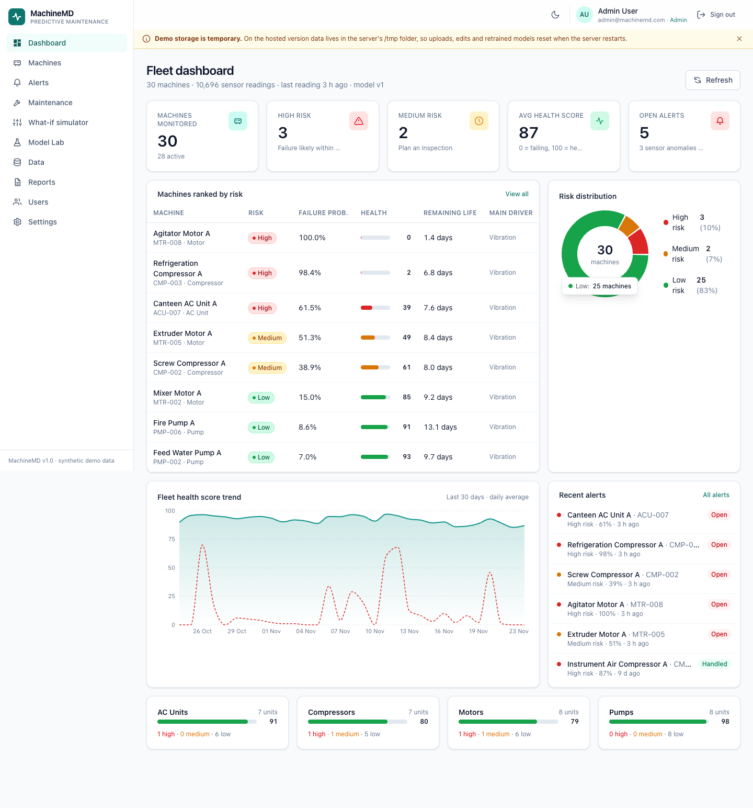
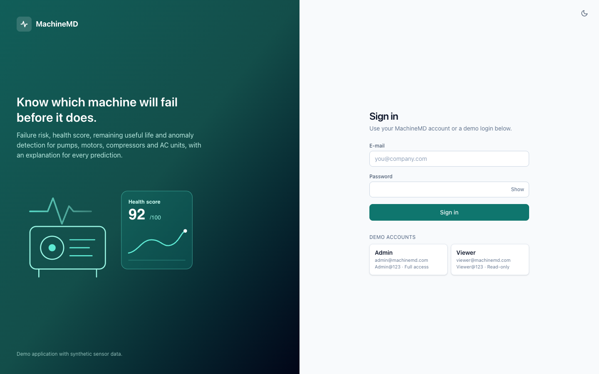
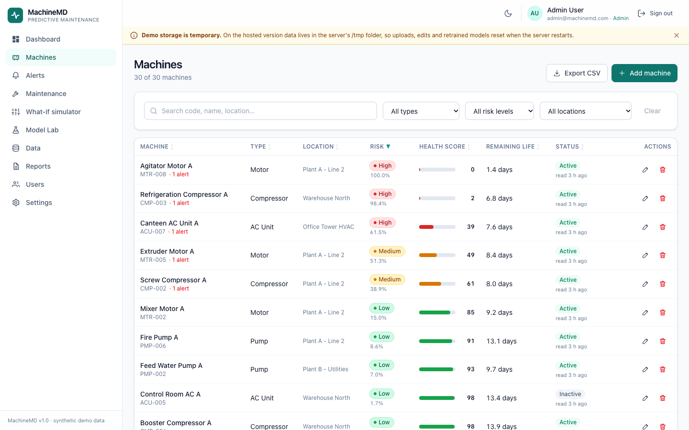
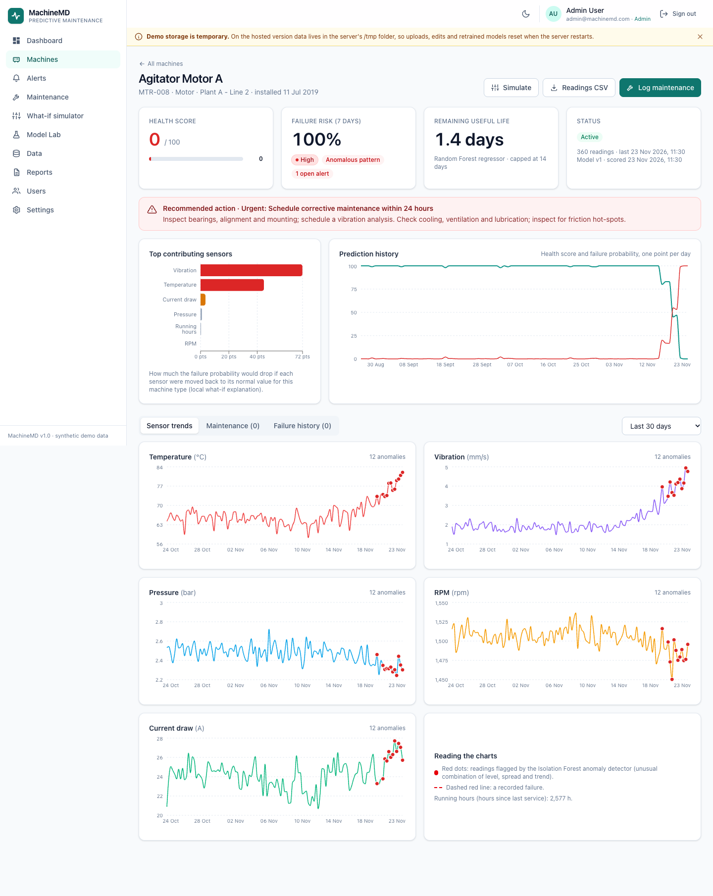
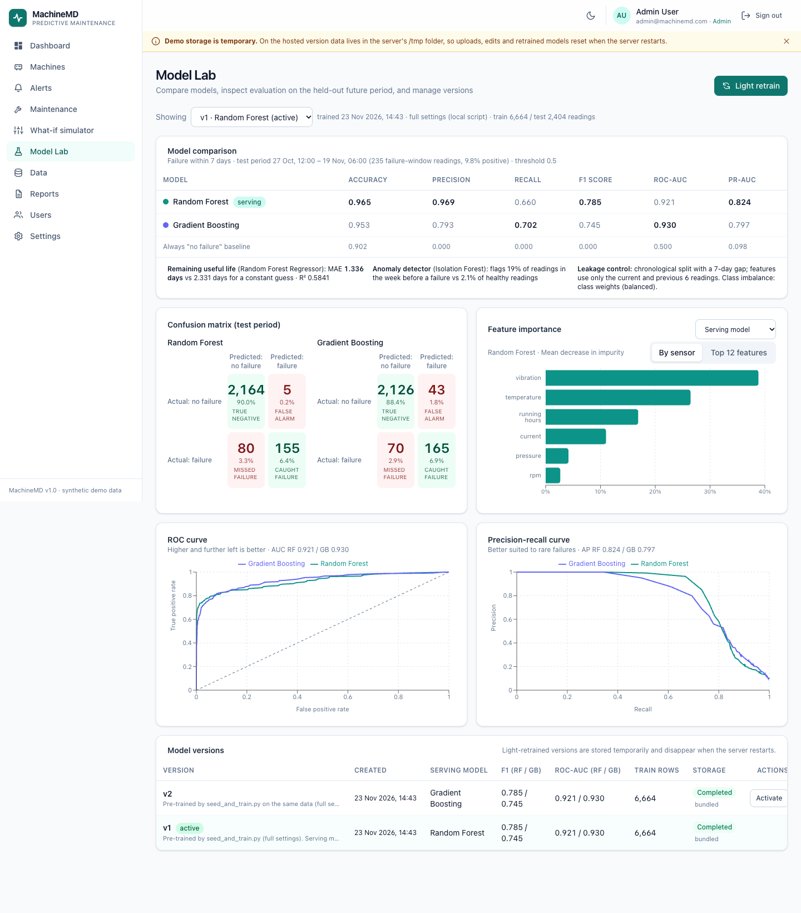
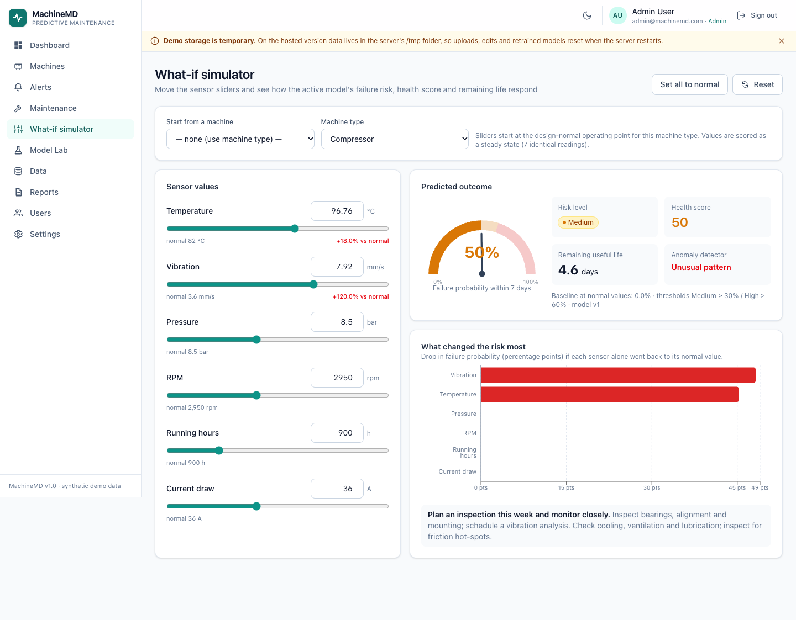
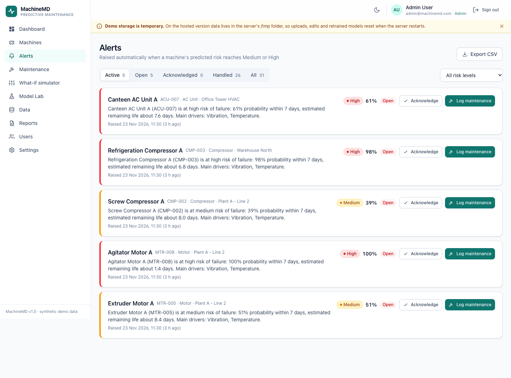
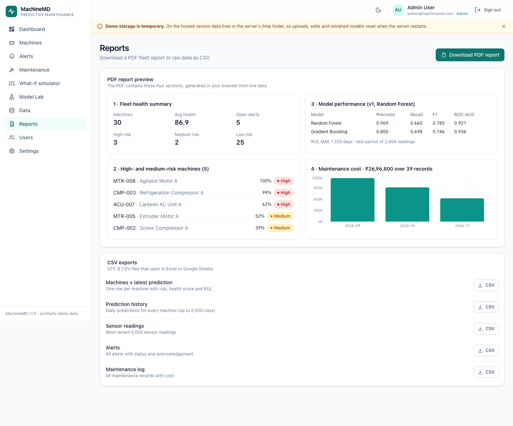
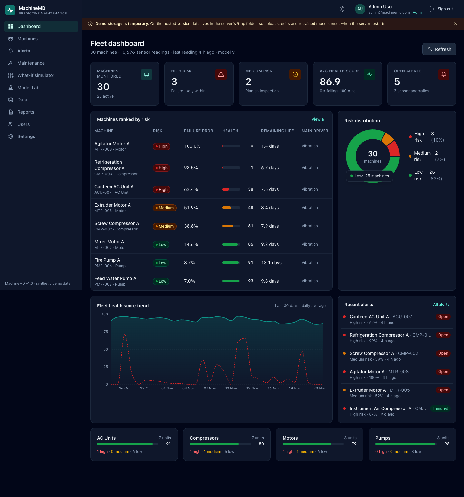
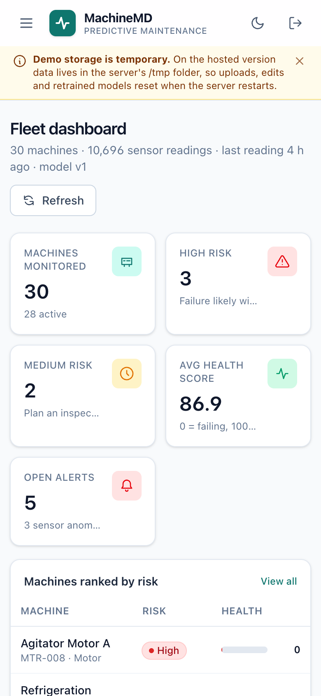

# MachineMD — predictive maintenance

**Know which machine will fail before it does.** MachineMD predicts which pumps, motors, compressors and AC units are likely to fail soon from their sensor readings. Every prediction comes with a health score, a remaining-useful-life estimate, an anomaly flag and an explanation of which sensors drive the risk.

Full-stack app: a React frontend plus a FastAPI backend with a real scikit-learn pipeline (data → features → training → evaluation → prediction → explanation). It deploys to Vercel as **one project at one URL**.

- **Live site:** **https://machinemd.vercel.app** (tested end to end: 65/65 acceptance + 15/15 flow checks on the live deployment)
- **Repository:** https://github.com/DIVYAPRIYADHARSHINI-GIT/machinemd
- **Final report:** [`reports/MachineMD_Final_Report.pdf`](reports/MachineMD_Final_Report.pdf) ([Markdown copy](reports/MachineMD_Final_Report.md))

> **Demo storage is temporary.** On Vercel the database is a copy in `/tmp`, so uploads, edits and retrained models reset when the server restarts. The committed seed data and pre-trained models always come back. The app shows this note in a banner.



## Demo logins

| Role | E-mail | Password | Access |
| --- | --- | --- | --- |
| Admin | `admin@machinemd.com` | `Admin@123` | Everything: upload data, retrain/activate models, manage machines, users and the maintenance log |
| Viewer | `viewer@machinemd.com` | `Viewer@123` | Read-only: dashboard, machines, predictions, Model Lab, reports. Edit controls are hidden and the API returns 403 |

## Features

| Area | What you get |
| --- | --- |
| **Dashboard** | KPI cards (machines monitored, high risk, medium risk, average health score, open alerts), machines ranked by risk, risk-distribution donut, 30-day fleet health trend, recent alerts, per-type summary |
| **Machines** | Search, filters (type, risk, location), sortable columns, health-score bars, risk badges, add/edit/delete (admin), CSV export |
| **Machine detail** | Temperature, vibration, pressure, RPM and current trend charts with anomaly points and failures marked; health score; RUL; top contributing sensors; prediction history; maintenance and failure history; recommended action |
| **Data** | CSV upload with automatic + manual column mapping, validation, preview and a per-row error report (valid rows are still imported); downloadable template; single-reading entry; batch prediction from a small CSV |
| **Model Lab** | Random Forest vs Gradient Boosting comparison table, confusion matrices, ROC and precision-recall curves, feature importance (by sensor and by feature), model-version list with **Activate**, **Light retrain** |
| **What-if simulator** | A slider per sensor, live risk gauge, health score, RUL, anomaly flag and a "what changed the risk most" chart; start from a machine type or from any machine's latest reading |
| **Alerts** | Raised automatically for Medium/High risk; filter by status and risk; acknowledge; log maintenance from the alert, which marks it **Handled** |
| **Maintenance log** | List/search/filter, add, edit, delete (with confirmation), cost totals |
| **Reports** | PDF fleet report (fleet health summary, high-risk machines, model performance, maintenance cost), generated in the browser; CSV exports of machines, predictions, readings, alerts and maintenance |
| **Users / Settings** | Admin user management; editable risk thresholds; change password; activity log; system status; reset demo data |
| **UX** | Sidebar + top bar, responsive down to 360 px, light and dark mode, loading skeletons, empty states, toasts, confirm dialogs, a "Waking up the server, please wait..." message for slow first requests |

## ML approach

**Data.** A built-in deterministic generator (`backend/ml/generator.py`, numpy only, no downloads) creates **30 machines** (8 pumps, 8 motors, 7 compressors, 7 AC units) with **90 days of readings every 6 hours**: temperature, vibration, pressure, RPM, running hours (since last service) and current draw. That gives 10,696 readings and 26 recorded failures.

- Before a failure, degradation follows four realistic patterns: gradual wear (temperature and vibration climb over 7–16 days), fast faults (2–4 days of warning), electrical faults (mostly current) and cooling faults (mostly temperature).
- Noise and confounders keep the task honest: load swings, a daily temperature cycle, per-machine calibration offsets, harmless "hot spells", sensor glitches, and running hours that reset at services.
- **7.4 %** of labelled readings fall in the 7 days before a failure (class imbalance).
- Eight machines are degrading *right now* towards failures after the end of the data, so the live dashboard has real high-risk machines. Those future failures are never stored, so they cannot leak into the labels.

**Features** (`backend/ml/features.py`). For each of the 6 sensors: the raw value plus the rolling **mean**, **std** and least-squares **trend (slope)** over the last 7 readings of the same machine, giving **24 features**. Values are normalised to each machine type's design-normal point, so one model serves all four types.

**Models** (`backend/ml/train.py`)

| Model | Purpose | Details |
| --- | --- | --- |
| Random Forest classifier | P(failure within 7 days) | `class_weight="balanced_subsample"`, monotonic constraints, probabilities calibrated on out-of-bag predictions |
| Gradient Boosting classifier | P(failure within 7 days), for comparison | scikit-learn `HistGradientBoostingClassifier`, `class_weight="balanced"`, monotonic constraints |
| Random Forest regressor | Remaining useful life (days) | trained on days-to-failure capped at 14 days |
| Isolation Forest | Anomaly detection | fitted on healthy training readings |

- **Health score** = `100 × (1 − P(failure))`.
- **Risk level:** Low < 30 % ≤ Medium < 60 % ≤ High. Admins can change the thresholds in Settings.
- **Monotonic constraints** encode physics: hotter, shakier, higher current or lower pressure/RPM can never *lower* the risk, so the what-if simulator always behaves sensibly.

**Leakage control.**
1. Features only look at the current and previous 6 readings.
2. The train/test split is **chronological**: train on readings more than 7 days before the cutoff, test on readings after it. The 7-day gap means no training label "sees" the test period.
3. Readings near the end of the data whose outcome is unknown are **censored** (left unlabelled) instead of being called healthy.
4. Calibration uses out-of-bag predictions, never test data.

**Explainability without SHAP.**
- *Global:* impurity importance for the Random Forest and permutation importance (drop in PR-AUC) for Gradient Boosting.
- *Per machine:* a **local what-if**. Each sensor in turn is moved back to its normal value across the 7-reading window, the model is re-run, and the drop in risk is that sensor's contribution. All 7 variants are scored in one call.

### Results (real numbers, held-out future period)

Test period: 2,404 readings, 235 of them within 7 days of a failure (9.8 %), threshold 0.5. These values come from `backend/data/metrics.json`, written by the training script.

| Model | Accuracy | Precision | Recall | F1 | ROC-AUC | PR-AUC | TP / FP / FN / TN |
| --- | --- | --- | --- | --- | --- | --- | --- |
| **Random Forest (serving, v1)** | 0.965 | 0.969 | 0.660 | **0.785** | 0.921 | **0.824** | 155 / 5 / 80 / 2,164 |
| Gradient Boosting (v2) | 0.953 | 0.800 | 0.698 | 0.746 | **0.936** | 0.803 | 164 / 41 / 71 / 2,128 |
| Always "no failure" | 0.902 | 0 | 0 | 0 | 0.5 | 0.098 | — |

- **RUL regressor:** MAE **1.34 days** vs 2.33 days for a constant guess (R² 0.58).
- **Isolation Forest:** flags 18.7 % of readings in the week before a failure vs 2.1 % of healthy readings.
- **Top sensors:** vibration (39 %), temperature (26 %), running hours (17 %), current (11 %).
- Accuracy alone is misleading here (the do-nothing baseline already scores 0.90), so F1 and PR-AUC drive model choice.
- **Random Forest serves by default:** it has the best F1 and PR-AUC and only 5 false alarms. Gradient Boosting catches 9 more failures at the cost of 36 more false alarms. Both are shipped, and an admin can switch in Model Lab.

## Tech stack

- **Frontend:** React 19, Vite 8, Tailwind CSS 4, React Router 7, Recharts 3, jsPDF (PDF report, loaded on demand)
- **Backend:** Python 3.12, FastAPI, SQLAlchemy 2 + SQLite, numpy, scikit-learn, joblib, bcrypt, PyJWT. No pandas, SHAP, TensorFlow or PyTorch.
- **Deployment:** Vercel Hobby. The Vite build is served as static files and FastAPI runs as one Python serverless function under `/api`.
- **Tests:** pytest (34 API/ML/multi-instance tests) and a headless-Chrome suite (puppeteer-core with the installed Chrome) with 65 acceptance checks plus 15 flow checks, run locally, on a fresh GitHub clone, on two isolated instances behind a round-robin proxy, and on the live site
- **Pinned ML versions:** numpy 2.2.6, scipy 1.16.3 and scikit-learn 1.7.2, the newest releases with manylinux2014 wheels. This lets Vercel's Python builder install them at runtime instead of bundling them (see [Vercel limits handled](#vercel-limits-handled)).

## Folder structure

```
machinemd/
├── api/index.py               Vercel entrypoint (exposes the FastAPI app)
├── vercel.json                build + rewrites + function config
├── requirements.txt           trimmed runtime deps for the Python function
├── backend/
│   ├── app/                   FastAPI app: main.py, routers/, services/, models.py, security.py, sync.py (multi-instance journal)
│   ├── ml/                    generator, features, dataset/labels, training, serving + explanations
│   ├── scripts/seed_and_train.py
│   ├── data/                  machinemd.db (seeded), models/*.joblib, metrics.json  ← committed
│   └── tests/                 pytest suite
├── frontend/                  React app (src/pages, src/components, src/lib)
├── e2e/                       headless-Chrome acceptance tests + screenshot scripts
├── docs/screenshots/          images used in this README
└── reports/                   final report (PDF + MD), bug log, screenshots
```

## Run locally

Prerequisites: Python 3.12 and Node.js 20 or newer.

```bash
git clone https://github.com/DIVYAPRIYADHARSHINI-GIT/machinemd.git
cd machinemd

# Backend
python3.12 -m venv .venv
source .venv/bin/activate            # Windows: .venv\Scripts\activate
pip install -r backend/requirements-dev.txt
cd backend && uvicorn app.main:app --port 8000      # http://127.0.0.1:8000/api/docs

# Frontend (second terminal)
cd frontend
npm ci
npm run dev                                          # http://localhost:5173  (proxies /api to :8000)
```

Open http://localhost:5173 and sign in with a demo account. The committed database and models are used as-is; nothing needs to be trained first.

- **Regenerate data and models:** `python backend/scripts/seed_and_train.py` (about 16 s). It rewrites `backend/data/machinemd.db`, `backend/data/models/*.joblib` and `backend/data/metrics.json`.
- **Tests:** `python -m pytest backend` (API/ML). For the browser suite, run `cd e2e && npm ci && node acceptance.mjs` with both servers running.
- **Production-like run:** `cd frontend && npm run build && npm run preview` serves the built files on :4173 with the same `/api` proxy.

Like Vercel, the backend never writes into the repo. On start it copies `backend/data/machinemd.db` to `<temp>/machinemd/` (change with `MACHINEMD_DATA_DIR`) and works on the copy.

**Self-healing:** a missing database is regenerated, and a missing model file is replaced by the newest available version or by a freshly trained light model.

## Environment variables (names only)

All are optional (see [`.env.example`](.env.example)):

- `MACHINEMD_JWT_SECRET`
- `MACHINEMD_JWT_EXPIRE_MINUTES`
- `MACHINEMD_DATA_DIR`
- `MACHINEMD_CORS_ORIGINS`
- `VITE_API_PROXY` (dev only)

Setting `MACHINEMD_JWT_SECRET` to a long random value is recommended for any public deployment. `/api/health` reports whether it is set, never its value.

## Deploy to Vercel

No CLI, no tokens. In the Vercel dashboard:

1. **Add New… → Project** → find `DIVYAPRIYADHARSHINI-GIT/machinemd` under *Import Git Repository* → **Import**.
2. **Framework Preset:** `Other`.
3. **Root Directory:** leave it as `./` (the repository root). Do **not** pick `frontend`. If Vercel suggests the **Services** preset ("Multiple applications detected"), switch the preset to **Other** and do not click "Import single project".
4. **Build and Output Settings:** leave every override off. `vercel.json` already sets the install command (`cd frontend && npm ci`), the build command (`cd frontend && npm run build`) and the output directory (`frontend/dist`).
5. *(Optional)* **Environment Variables:** add `MACHINEMD_JWT_SECRET` with any long random string.
6. Click **Deploy**. When it finishes, open the URL and sign in with a demo account.

**How it works:**
- Vercel serves `frontend/dist` as static files.
- `api/index.py` becomes a Python function. Its dependencies come from the root `requirements.txt`, and the Python version from `.python-version` (3.12).
- `vercel.json` rewrites `/api/*` to the function and every other route to `index.html`.
- The function bundle includes `backend/app`, `backend/ml` and `backend/data`. I validated the build with the Vercel builder itself (`vercel build`, offline): it completes and produces one `python3.12` function. Because the pinned wheels are manylinux2014, Vercel's optimizer keeps the bundle under its 225 MB packing limit and installs the remaining public packages at cold start into `/tmp/_vc_deps`.

## Vercel limits handled

| Limit | How MachineMD handles it |
| --- | --- |
| Read-only filesystem except `/tmp` | The seeded SQLite file is copied to `/tmp/machinemd` on cold start; all writes go there. Retrained models are saved to `/tmp/machinemd/models`. |
| Short function time limits | Models are pre-trained locally and committed. Requests are fast: the slowest read endpoint took 60 ms (5,000-row CSV export) and most take under 15 ms locally. A light retrain takes about 3 s. |
| Python bundle size | No pandas, SHAP or deep-learning libraries; tests, scripts, reports and the frontend are excluded from the function. numpy/scipy/scikit-learn are pinned to releases with manylinux2014 wheels. With newer releases the local `vercel build` failed with `LAMBDA_SIZE_EXCEEDED` (246 MB > 225 MB); with the pins it completes. |
| Instances are recycled | Changes reset to the seed; the UI says so. Self-healing covers a missing database or model file. |
| Several instances run at once, each with its own `/tmp` database | A signed change journal (`backend/app/sync.py`) keeps them consistent: each admin change comes back HMAC-signed in `X-MachineMD-Op`, the browser sends the ordered journal with every request, and any instance replays the changes it has not applied (same user, same timestamp, deterministic retrain). Verified live: 12/12 parallel requests see a retrain, a reset and a sign-out. |
| Cold starts | The login page pings `/api/health` while you type, and slow requests show "Waking up the server, please wait...". |

## API summary

All routes are under `/api`; interactive docs at `/api/docs`. Admin = admin only; Any = any signed-in user.

| Method | Path | Access | Purpose |
| --- | --- | --- | --- |
| GET | `/health` | Public | Health check (database, active model, storage note) |
| POST | `/auth/login` | Public | Sign in. Rate limited: 5 failures per 5 minutes per IP and per e-mail |
| POST | `/auth/logout` | Any | Revoke the current token |
| GET | `/auth/me` | Any | Current user |
| POST | `/auth/change-password` | Any | Change own password |
| GET, POST | `/users` | Admin | List / create users |
| PUT, DELETE | `/users/{id}` | Admin | Update / delete a user |
| GET | `/machines` | Any | List with latest prediction (filters: `search`, `type`, `risk`, `location`, `status`) |
| GET | `/machines/meta` | Any | Types, statuses, locations |
| GET | `/machines/{id}` | Any | Detail: readings with anomaly flags, prediction, contributions, maintenance, failures |
| POST | `/machines` | Admin | Create a machine |
| PUT, DELETE | `/machines/{id}` | Admin | Update / delete a machine |
| GET | `/readings` | Any | List readings (paged) |
| POST | `/readings` | Admin | Add one reading; the machine is re-scored |
| GET | `/readings/template` | Any | CSV template |
| POST | `/readings/upload` | Admin | CSV upload: mapping, validation, preview (`dry_run`), import of valid rows (max 2,000 rows / 512 KB) |
| GET | `/predictions/latest` | Any | Latest prediction per machine |
| GET | `/predictions/machine/{id}` | Any | Machine prediction with contributions and recommended action |
| GET | `/predictions/machine/{id}/history` | Any | Prediction history |
| POST | `/predictions/single` | Any | Predict from sensor values |
| POST | `/predictions/batch` | Any | Predict a small CSV (max 500 rows, nothing saved) |
| POST | `/predictions/refresh` | Admin | Re-score all machines |
| GET | `/models` | Any | Model versions with metrics |
| GET | `/models/active` | Any | Active version with curves and confusion matrices |
| GET | `/models/{version}/metrics` | Any | Metrics, ROC/PR data, confusion matrix |
| GET | `/models/{version}/feature-importance` | Any | Global feature importance |
| POST | `/models/{version}/activate` | Admin | Set the active model; all machines are re-scored |
| POST | `/models/retrain` | Admin | Light retrain to a new version (temporary storage) |
| DELETE | `/models/{version}` | Admin | Delete a retrained version |
| GET | `/whatif/defaults` | Any | Slider ranges and starting values |
| POST | `/whatif` | Any | Risk, health score, RUL and top contributing sensors for given values |
| GET, POST | `/maintenance` | Any / Admin | List / log maintenance (handles the machine's open alert) |
| PUT, DELETE | `/maintenance/{id}` | Admin | Edit / delete a record |
| GET | `/alerts` | Any | List alerts (filters: `status`, `risk`, `machine_id`) |
| POST | `/alerts/{id}/acknowledge` | Admin | Acknowledge an alert |
| GET | `/dashboard/summary` | Any | KPIs, ranking, distribution, trend, recent alerts |
| GET | `/reports/summary` | Any | Data for the PDF report |
| GET | `/reports/export/{kind}` | Any | CSV export: machines, predictions, readings, maintenance, alerts |
| GET | `/settings` | Any | Risk thresholds and limits |
| PUT | `/settings/thresholds` | Admin | Change risk thresholds (risk levels and alerts update) |
| GET | `/activity` | Any | Activity log |
| POST | `/admin/reset-demo` | Admin | Restore the committed seed data and models |

Errors always come back as JSON `{"detail": ..., "code": ...}` with the matching HTTP status (400, 401, 403, 404, 409, 413, 422, 429, 503). Validation errors also list each field.

## Screenshots

| | |
| --- | --- |
|  |  |
|  |  |
|  |  |
|  |  |



## Known limitations

- The data is synthetic. The patterns are realistic but not from real machines, so the metrics describe this simulation, not a real plant.
- Hosted storage is temporary (see the note at the top). For persistence, point SQLAlchemy at a hosted database.
- The login rate limiter is per server instance. Shared state on Vercel is kept consistent by the browser's signed change journal, so it is consistent *per browser*: a different browser (or a copied token sent without the journal) can still reach an instance that has not seen the changes until that instance is recycled. A hosted database would remove this limitation.
- RUL is capped at 14 days: beyond that the model only says "no failure expected soon".

Built by **Divya Priyadharshini** · v1.0.0 · November 2026
