# MachineMD — Bugs & Improvements Report

**Version 1.0.0 · 25 November 2026 · Built and tested by Divya Priyadharshini**

| | |
| --- | --- |
| Live site | https://machinemd.vercel.app |
| GitHub | https://github.com/DIVYAPRIYADHARSHINI-GIT/machinemd |
| Demo logins | Admin `admin@machinemd.com` / `Admin@123` · Viewer `viewer@machinemd.com` / `Viewer@123` |

This report lists every bug I found while testing MachineMD, how each one was fixed, and the features I improved along the way. I took every "before" screenshot when the problem happened and every "after" screenshot after re-testing the fix.

## Summary

| | Count |
| --- | --- |
| Bugs found and fixed | **8** (6 found locally, 2 found only on the live Vercel site) |
| Bugs still open | **0** |
| Deployment problems fixed | **1** (Vercel bundle-size limit) |
| Features improved | **8** |
| Final test result on the live site | **65/65** acceptance checks · **15/15** flow checks |
| Final test result locally | 65/65 acceptance · 15/15 flows · 34/34 backend tests |

| ID | Problem | Where found | Severity | Status |
| --- | --- | --- | --- | --- |
| BUG-01 | Page scrolls sideways on mobile | Local, mobile | Medium | Fixed |
| BUG-02 | Machine search drops typed letters | Local | High | Fixed |
| BUG-03 | Form dialogs lose focus and close while typing | Local | High | Fixed |
| BUG-04 | Toast message covers buttons on the last table rows | Local | Low | Fixed |
| BUG-05 | After sign-out, next sign-in opens the previous user's page | Local | Low | Fixed |
| BUG-06 | What-if simulator disagrees with the machine's real prediction | Local | High | Fixed |
| BUG-07 | Data changes from one page load to the next | **Live site** | High | Fixed |
| BUG-08 | Sign-out did not log you out everywhere | **Live site** | Medium | Fixed |

---

## Part 1 — Bugs faced and fixed

### BUG-01 · Medium · Page scrolls sideways on mobile

**Where:** Dashboard and Reports, phone width (390 px).

**What happened:** the page was 407 px wide on a 390 px screen, so it wobbled sideways. The chart card and the recent-alerts card stuck out past the edge.

**Cause:** chart containers inside the page grid refused to shrink below their natural width.

**Fix:** allowed every grid item to shrink to the screen width (one CSS rule).

**Re-test:** 0 px sideways overflow on all 11 pages at phone width, in light and dark mode.

<figure>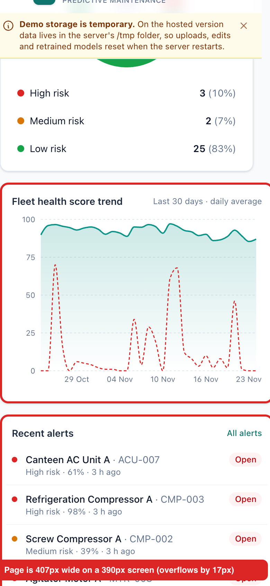<figcaption>Before: cards outlined in red stick out (17 px overflow)</figcaption></figure>
<figure>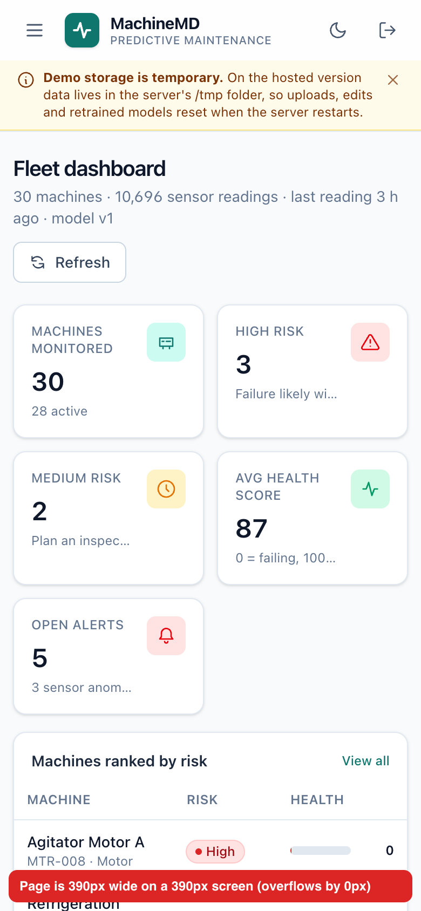<figcaption>After: everything fits the phone screen</figcaption></figure>

### BUG-02 · High · Machine search drops typed letters

**Where:** Machines list, search box.

**What happened:** typing "compressor" quickly left only "or" in the box, and the table showed 17 wrong machines instead of the 7 compressors.

**Cause:** every keystroke rewrote the page address, and the box read its text back from the address, which lagged behind fast typing.

**Fix:** the search box now keeps its own text. It updates the address only after a short pause.

**Re-test:** "compressor" stays intact and the table shows exactly 7 machines.

<figure>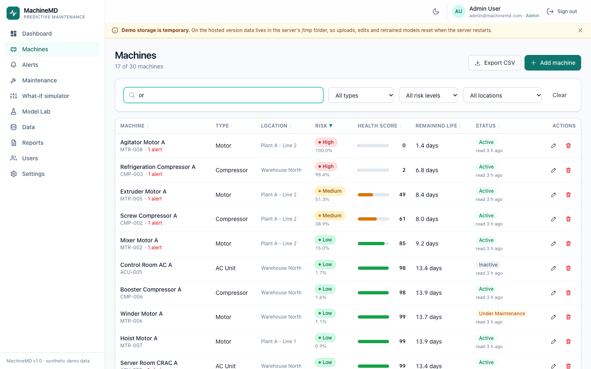<figcaption>Before: box shows "or", 17 of 30 machines</figcaption></figure>
<figure>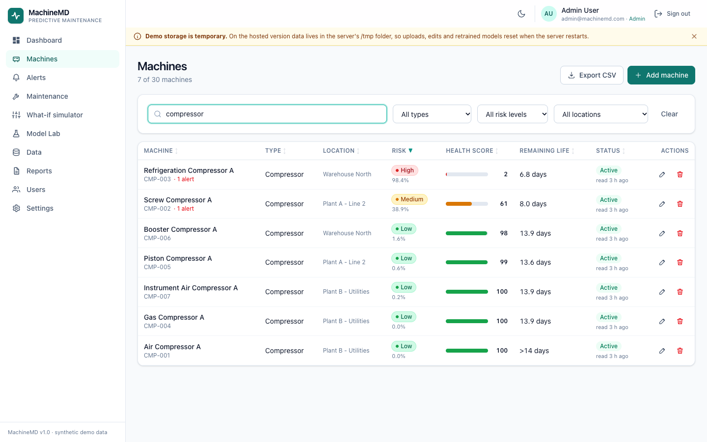<figcaption>After: "compressor", 7 machines</figcaption></figure>

### BUG-03 · High · Form dialogs lose focus and close while typing

**Where:** every pop-up form: maintenance, machine, user and retrain.

**What happened:** after the first letter, the cursor jumped to the dialog's close (×) button. Pressing space then "clicked" it, the dialog closed, and the typed text was lost.

**Cause:** the dialog re-ran its "focus the first button" step on every keystroke.

**Fix:** the focus step now runs only once, when the dialog opens, and it focuses the first form field, never the close button.

**Re-test:** text stays in the field in every dialog in the app.

<figure>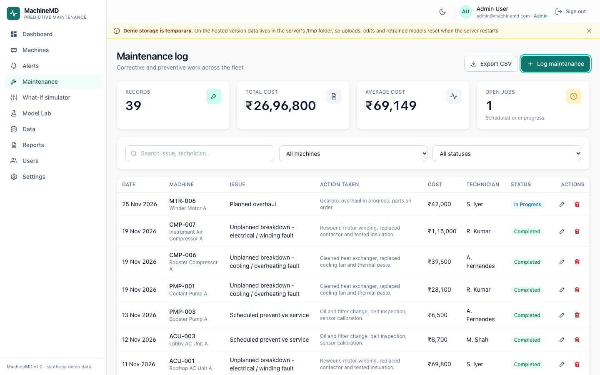<figcaption>Before: dialog closed itself, typed text lost</figcaption></figure>
<figure>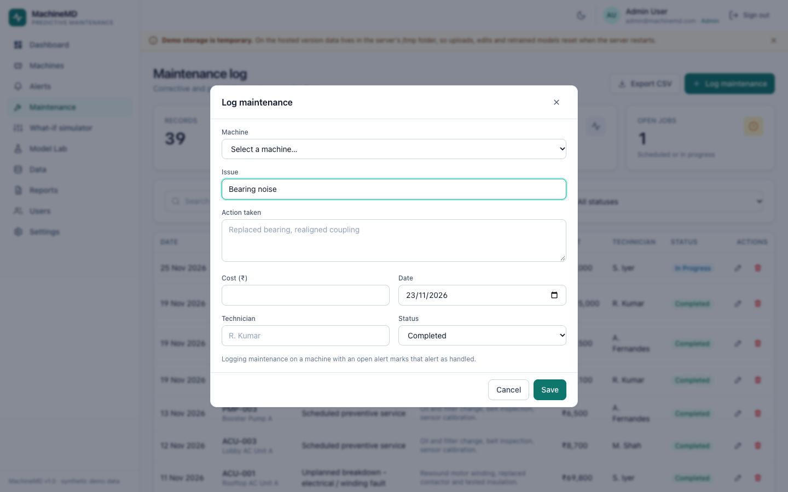<figcaption>After: "Bearing noise" stays in the Issue field</figcaption></figure>

### BUG-04 · Low · Toast message covers buttons on the last table rows

**Where:** Machines list (and other tables).

**What happened:** after adding a machine, the success message at the bottom-right sat on top of the new row's Edit and Delete buttons, so clicking Edit did nothing.

**Fix:** added space at the bottom of every page so the last rows can scroll clear of messages.

**Re-test:** Edit on the newly added last row opens the form.

<figure>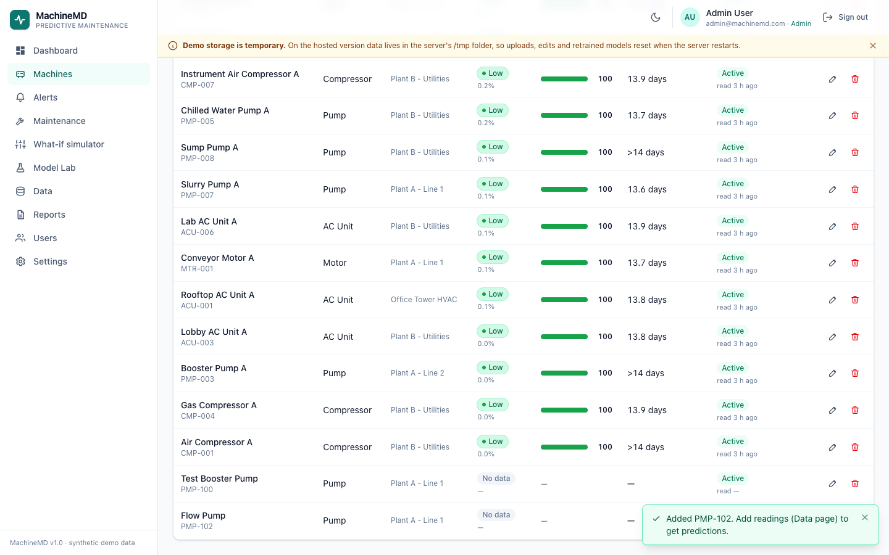<figcaption>Before: toast over the last rows' action buttons</figcaption></figure>
<figure>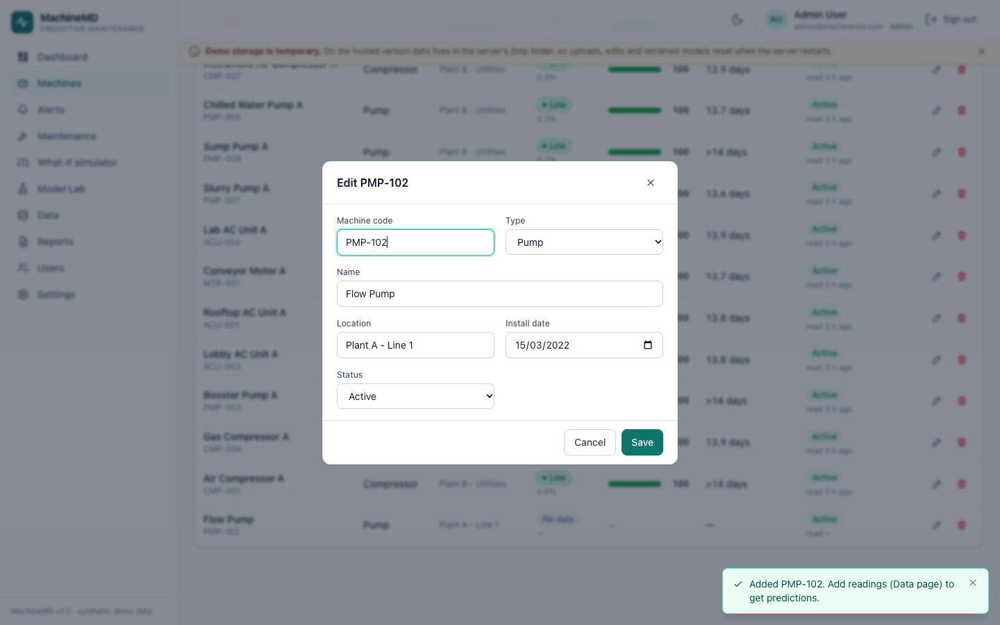<figcaption>After: Edit opens the form for the new machine</figcaption></figure>

### BUG-05 · Low · After sign-out, next sign-in opens the previous user's page

**Where:** Login.

**What happened:** user A signed out from Settings, and the next person to sign in landed on Settings instead of the Dashboard.

**Fix:** the app now remembers the last page only when a session expires on its own, not after a deliberate sign-out.

**Re-test:** a fresh sign-in opens the Dashboard; an expired session still returns you to where you were.

<figure>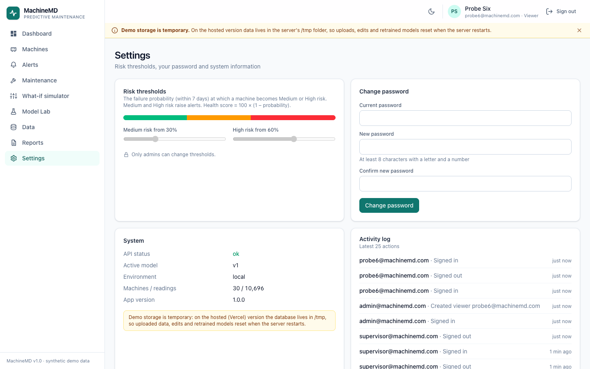<figcaption>Before: fresh sign-in opened /settings</figcaption></figure>
<figure>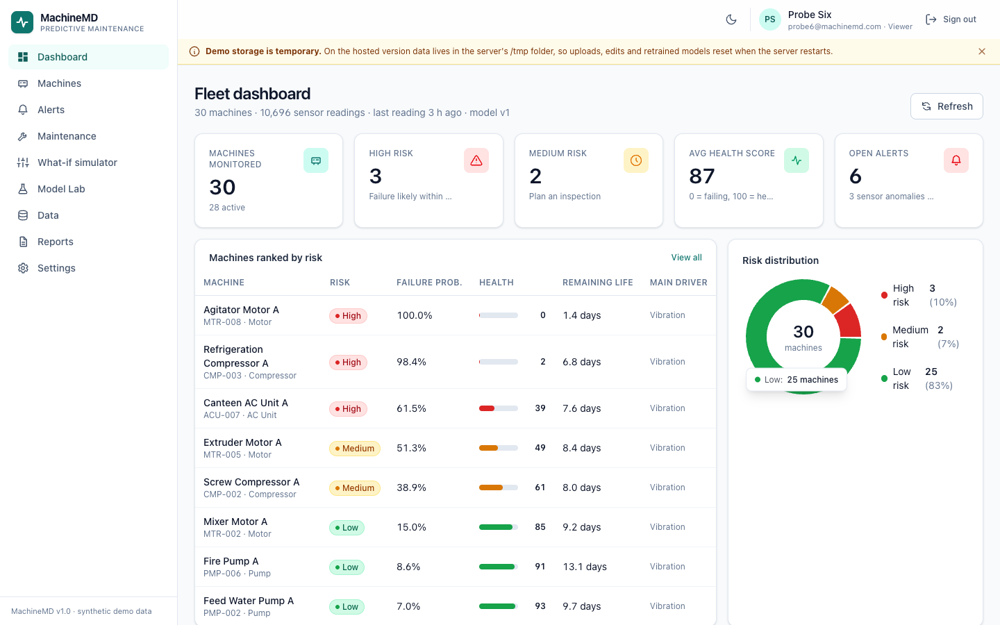<figcaption>After: fresh sign-in opens the Dashboard</figcaption></figure>

### BUG-06 · High · What-if simulator disagrees with the machine's real prediction

**Where:** What-if simulator, "Start from a machine".

**What happened:** for ACU-007 (real prediction **61 %, High risk**), the simulator showed **14 %, Low** before any slider was moved. A user could think a failing machine was fine. 8 of 30 machines showed a mismatch.

**Cause:** the simulator scored only the latest values as a flat, steady reading and ignored the machine's rising trend, which the real model relies on.

**Fix:** with a machine selected, the slider values now replace the machine's newest reading on top of its real recent history.

**Re-test:** all 30 machines match their real prediction, and raising temperature or vibration still always raises the risk. I added an automatic test to stop this coming back.

<figure>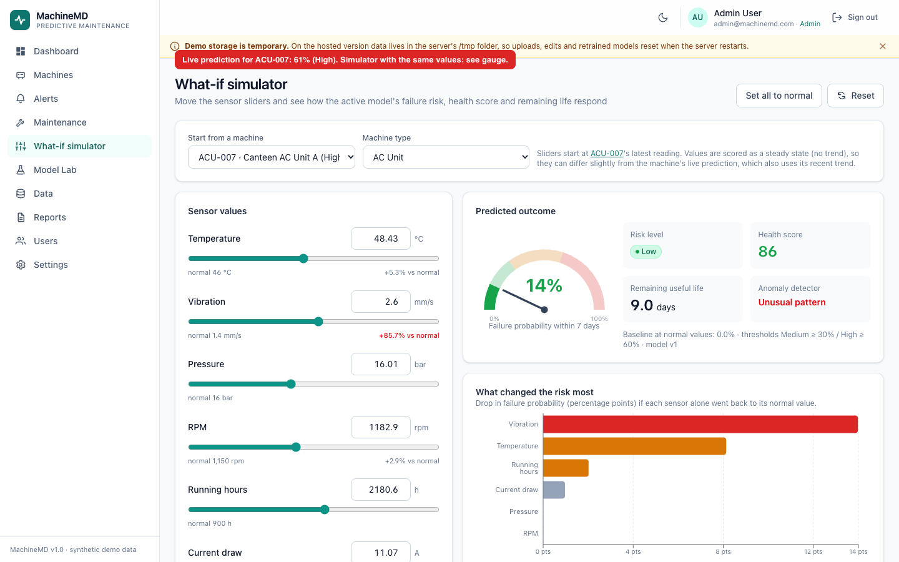<figcaption>Before: real prediction 61 % High, simulator 14 % Low</figcaption></figure>
<figure>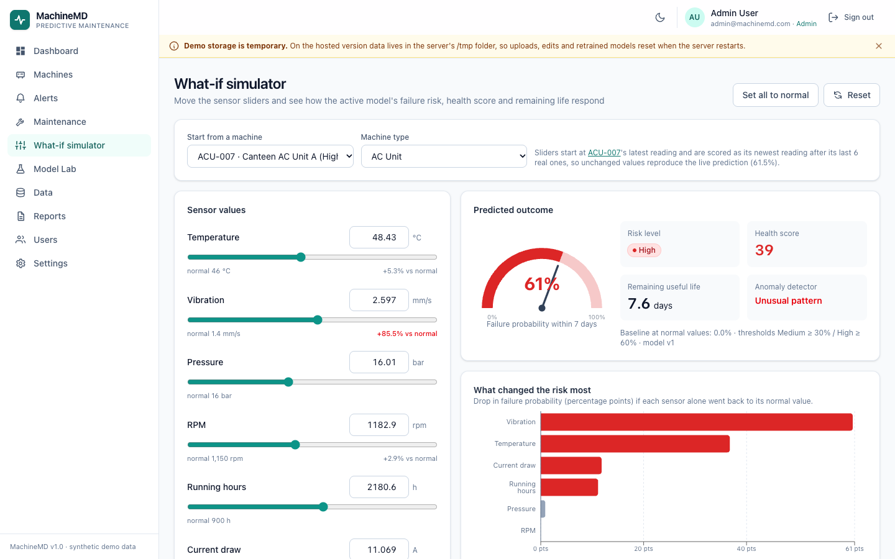<figcaption>After: simulator 61 % High, matching the real prediction</figcaption></figure>

### BUG-07 · High · Data changes from one page load to the next (live site only)

**Where:** https://machinemd.vercel.app. It affected every admin change: retrain, upload, maintenance, alerts and settings.

**What happened:** after retraining a new model (v3), only **8 of 12** requests showed it; the others still showed the old list. Uploads and maintenance records flickered in and out the same way.

**Cause:** Vercel runs several copies of the server at once, and each keeps its own temporary copy of the database. A change saved by one copy was invisible to the others. This cannot happen on a laptop, where there is only one copy.

**Fix (free, no extra database):**
1. Every admin change comes back to the browser with a tamper-proof signature.
2. The browser sends its list of changes with each request.
3. Whichever server copy answers first applies any changes it missed, as the same user and at the same time.
4. Forged changes are rejected, and passwords are never stored in the list.

**Re-test:** I reproduced the problem first on my laptop with two separate server copies, and fixed it there. On the live site, **12 of 12** requests now see the change, and the full live test suite passes 65/65.

<figure>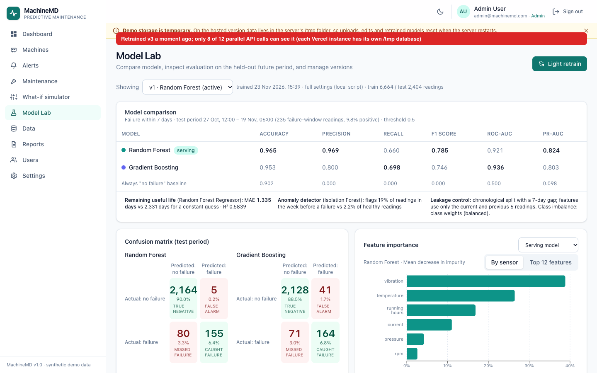<figcaption>Before (live): only 8 of 12 requests can see the new model v3</figcaption></figure>
<figure>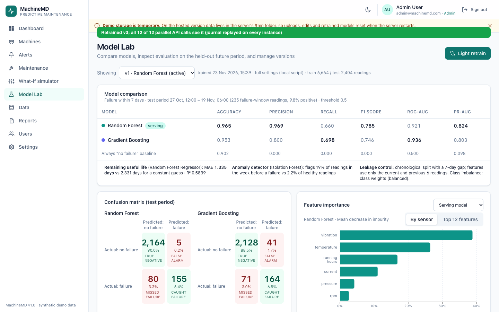<figcaption>After (live): all 12 of 12 requests see it</figcaption></figure>

### BUG-08 · Medium · Sign-out did not log you out everywhere (live site only)

**Where:** https://machinemd.vercel.app, Sign out.

**What happened:** after signing out, the old login still worked on **7 of 12** requests.

**Cause:** same as BUG-07. The "signed-out" record was saved in only one server copy.

**Fix:** sign-out now travels in the same signed change list, so every server copy applies it.

**Re-test:** on the live site, **0 of 12** requests accept the old login after sign-out.

<figure>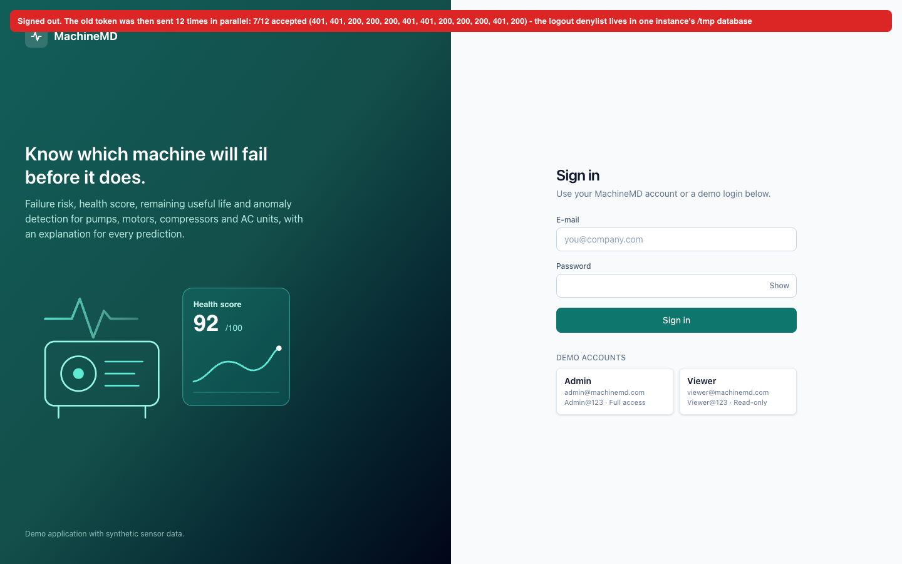<figcaption>Before (live): 7 of 12 requests still accept the signed-out login</figcaption></figure>
<figure>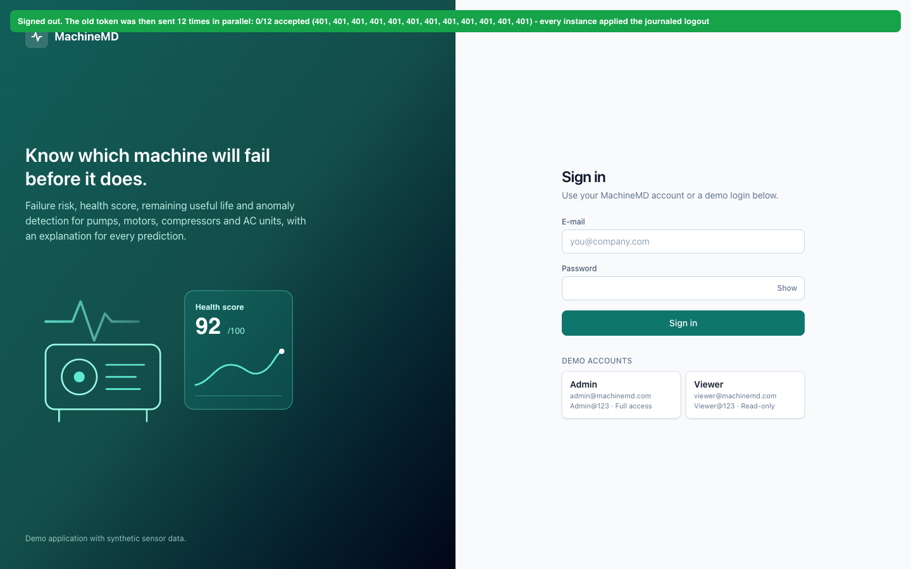<figcaption>After (live): 0 of 12 accept it</figcaption></figure>

### Deployment problem fixed before go-live: Vercel size limit

| | |
| --- | --- |
| What happened | A test build with Vercel's own build tool failed: the Python package bundle was **246 MB**, over Vercel's **225 MB** limit. |
| Cause | The newest numpy, scipy and scikit-learn releases are packaged in a way that forces Vercel to bundle them in full. |
| Fix | Pinned them to the newest versions Vercel can install at start-up instead (numpy 2.2.6, scipy 1.16.3, scikit-learn 1.7.2), retrained the models, and re-ran every test. |
| Result | The build completes and the site is live. The model scores were essentially unchanged. |

### Test-script problems (not app bugs)

Three failures during live testing came from my own test scripts, not from the app. I fixed the scripts:
- A number box could not be cleared by triple-click in the automated browser, so the test typed after the old value.
- Upload test rows sometimes clashed with existing readings later in the day. The app correctly rejected them as duplicates.
- A second test browser did not share the first one's change list.

---

## Part 2 — Features improved

### 1. What-if simulator now matches the real prediction

With a machine selected, the simulator now starts from that machine's real recent history (BUG-06 fix). The gauge, health score and remaining life you see before moving anything are the same as on the machine's own page. Moving a slider then shows a real "what if this sensor changed" result, and the bar chart shows which sensor drives the risk.

<figure class="shot">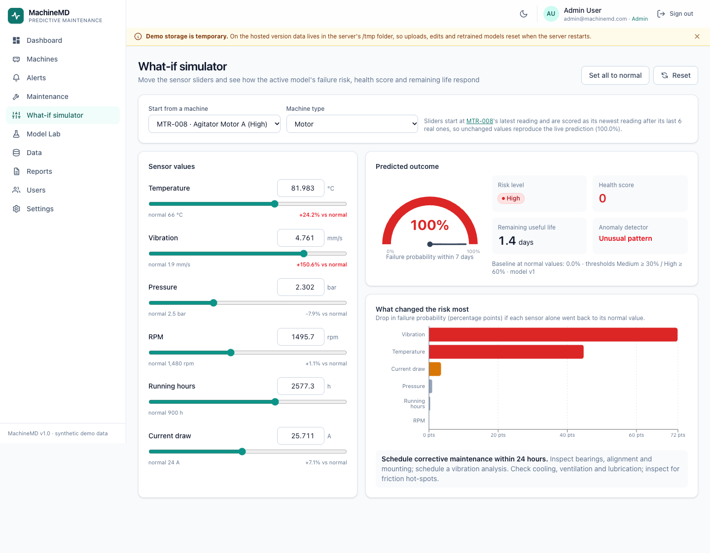<figcaption>Live: Agitator Motor A starts at its real 100 % High risk; vibration and temperature are shown as the main drivers, with a recommended action</figcaption></figure>

### 2. Consistent data on the live site

Every page on the live site now shows the same data on every request, even though Vercel runs several server copies (BUG-07/08 fix). This covers retrains, uploads, maintenance records, alerts, settings, users, demo reset and sign-out.

### 3. Faster, steadier typing in search and forms

The machine search keeps every letter, and the URL still updates so filters survive a page refresh. Every pop-up form keeps the cursor where you are typing (BUG-02/03 fixes).

### 4. Better mobile layout

No page scrolls sideways at phone width, in light or dark mode (BUG-01 fix). Every table row's buttons stay clickable (BUG-04 fix).

<figure>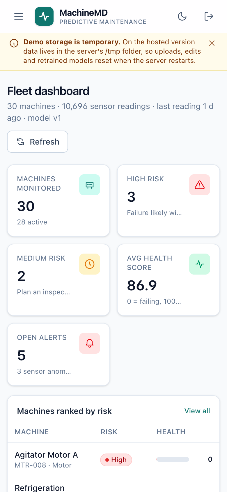<figcaption>Live: mobile dashboard</figcaption></figure>
<figure>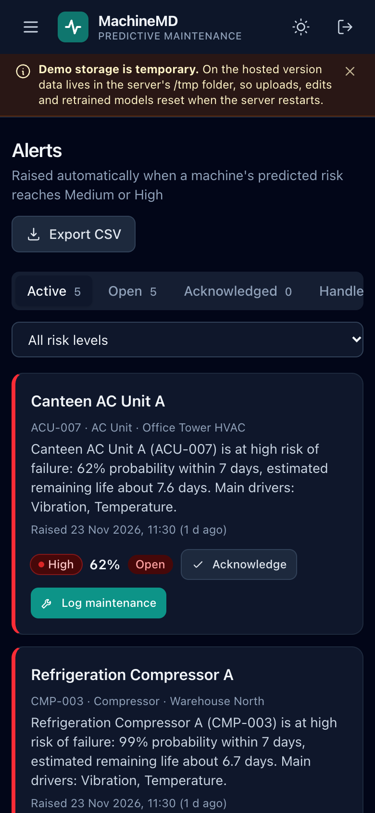<figcaption>Live: mobile, dark mode, alerts</figcaption></figure>

### 5. Safer sign-out and sign-in

Sign-out now ends the session on every server copy (BUG-08). The next person always starts on the Dashboard (BUG-05). Passwords are never sent around in the change list, only secure hashes.

### 6. Times entered with a time zone are saved correctly

Uploaded CSV times that include a time zone (for example `2026-11-23T12:00:00+05:30`) are converted correctly to UTC, so 12:00 IST is stored as 06:30 UTC. Before, the time zone was ignored. Invalid request data now gets a clear message ("Request body is not valid JSON") instead of a confusing one.

### 7. Real, honest model results

Random-forest probabilities are calibrated, so the health score reflects true risk: a healthy machine scores about 100, not 76. The Model Lab also shows a "do-nothing" baseline row, so the accuracy numbers can be judged fairly.

<figure class="shot">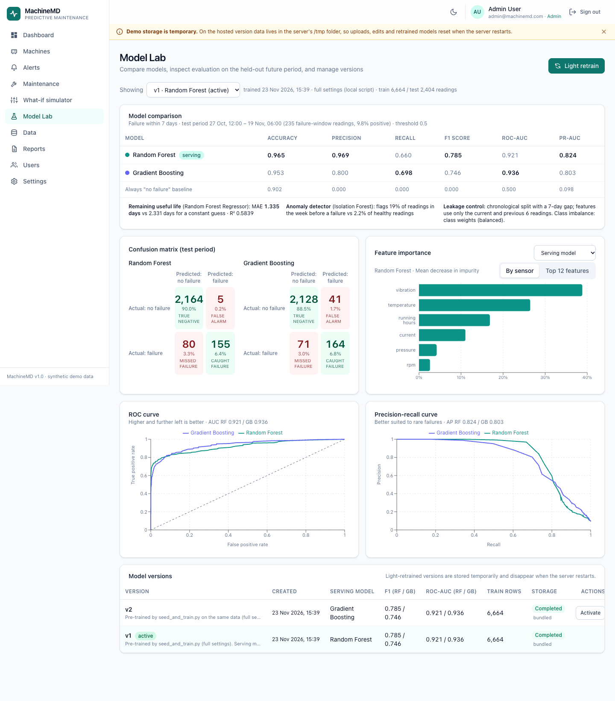<figcaption>Live: Model Lab: comparison table with baseline, confusion matrices, feature importance, ROC and precision-recall curves</figcaption></figure>

| Model | Accuracy | Precision | Recall | F1 | ROC-AUC |
| --- | --- | --- | --- | --- | --- |
| Random Forest (used for predictions) | 0.965 | 0.969 | 0.660 | 0.785 | 0.921 |
| Gradient Boosting (for comparison) | 0.953 | 0.800 | 0.698 | 0.746 | 0.936 |
| Always "no failure" baseline | 0.902 | 0 | 0 | 0 | 0.500 |

### 8. Clear "Waking up the server" message

When the free Vercel server has been idle, the first sign-in can take a few seconds. The login page now says so instead of looking frozen, and it starts waking the server while you type.

<figure>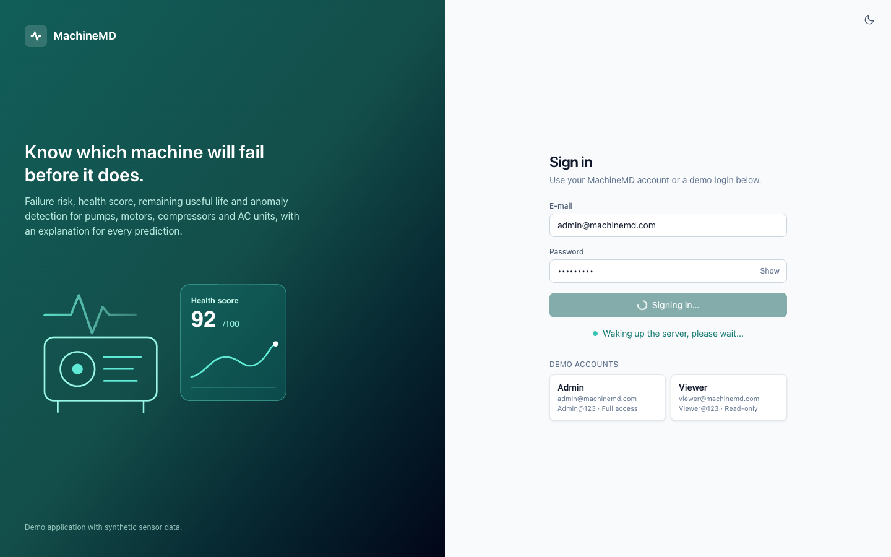<figcaption>Live: "Waking up the server, please wait..." during a slow first sign-in</figcaption></figure>
<figure>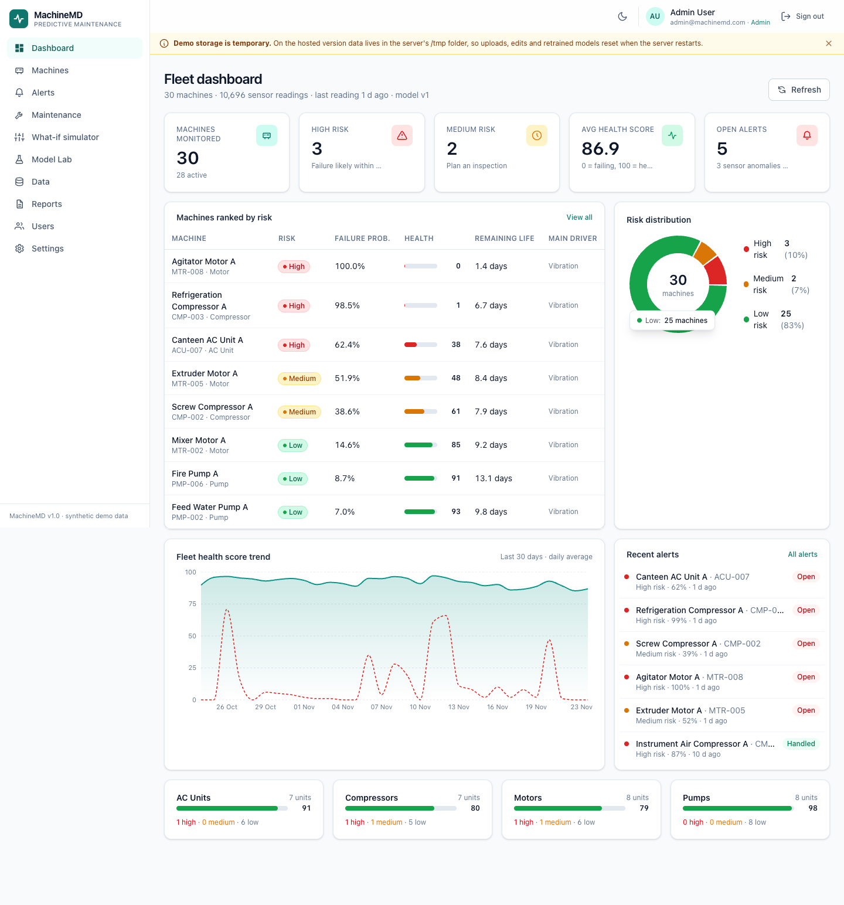<figcaption>Live: dashboard after sign-in</figcaption></figure>

---

## Known limitation

On the live site, data is kept consistent **per browser**. Someone using a *different* browser can briefly see older data until Vercel restarts that server copy. A hosted database (for example the free tier of Neon) would remove this. All data also resets when Vercel restarts the server, as the yellow banner in the app explains.

*MachineMD v1.0.0 · 25 November 2026 · Divya Priyadharshini*
